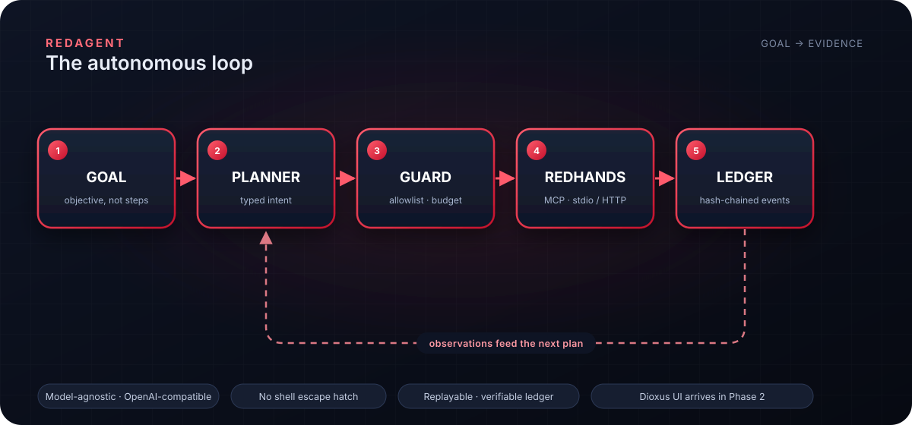

<div align="center">


# RedAgent

**Goal in. Evidence out.**

An autonomous offensive-security agent for [RedHands](https://github.com/yasindce1998/RedHands) — the tool plane that already wraps 294 security tools behind approval policies, scope gates and a full audit trail.

[](LICENSE)
[](Cargo.toml)
[](https://github.com/yasindce1998/RedAgent/actions/workflows/ci.yml)
[](#roadmap)
[](#quick-start)

</div>

---

## MCP gives you tools. RedAgent gives them a brain.

RedHands exposes capabilities. RedAgent decides **what to try next**, remembers what happened two steps ago, and binds every conclusion to the tool output that produced it. No shell free-for-all, no orphaned findings, no "what did the agent actually do?" moments.

| | |
|---|---|
| 🎯 **Goal-driven** | Describe the objective, not the command sequence. Typed intents replace brittle click-paths. |
| 🔗 **MCP-native execution** | Every action is a structured `tools/call` to RedHands — the same argv validation, approval policy and engagement scope operators already trust. |
| 🧾 **Receipts by default** | An append-only, hash-chained ledger records each intent, guard decision, tool result and finding. Reports are projections — audit is not an afterthought. |
| 🛡️ **Guardrails in code** | Allowlists and hard budgets are enforced before a call leaves the process, not hoped for in a prompt. |
| ⚡ **Two planes, one binary** | Go stays where it shines (the tool plane); Rust owns the control plane and, from Phase 2, the Dioxus UI. One protocol between them: MCP. |

> **Status:** Phase 0 foundation is shipped and tested end to end. The planner is deterministic today; a schema-validated LLM planner plugs into the same trait in Phase 1.

## How it works



## Quick start

Requires Rust stable and a checksum-verified **RedHands v0.6.3** binary (the pinned contract version).

```sh
cargo build --release

./target/release/redagent run "verify the lab tool plane" \
  --redhands /path/to/redhands \
  --ledger engagement.db

./target/release/redagent report  --ledger engagement.db   # re-render findings
./target/release/redagent verify  --ledger engagement.db   # check the hash chain
```

The engine spawns RedHands over stdio with a minimal toolset and redirects every state directory next to the ledger — your working directory stays clean, and the resulting `.db` is a portable, verifiable engagement record.

## Built different

- **No copied code, no license contamination.** Every line is original — RedAgent is clean-room, MIT, and yours.
- **No FFI, no sidecar services, no database server.** Two processes, one protocol, one Cargo.lock.
- **No hidden state.** Graphs, coverage and findings are projections of immutable events — replay, verify and export them at any time.
- **Operator-first safety.** Approved-tool gating lives in RedHands; RedAgent never gains a path around it. Authorized engagements only.

## Architecture

See [ADR 0001](docs/adr/0001-architecture.md) for the full decision record.

| Crate | Role |
|---|---|
| `redagent-core` | Event ledger, hash chain, projections, report rendering |
| `redagent-mcp` | Minimal dual-era MCP stdio client + test server |
| `redagent-agent` | `Planner` trait and the Phase 0 deterministic planner |
| `redagent-guard` | Tool allowlist and call budget |
| `redagent-app` | The single wiring point |
| `redagent-cli` | `run` / `report` / `verify` |

CI runs format, clippy, tests and release builds on Linux, macOS and Windows, plus a **live-e2e job** that downloads RedHands v0.6.3 with its published SHA-256 and drives the complete loop against the real Go server.

## Roadmap

| Phase | Deliverable | Status |
|---|---|---|
| 0 | Ledger, typed intent, MCP loop, guard, CLI, CI | ✅ shipped |
| 1 | LLM planner, worker/verifier, approval elicitation, budgets | next |
| 2 | Dioxus desktop UI + Axum REST/SSE projections | planned |
| 3 | Evidence blobs, retest loop, exports, Dioxus WASM web console | planned |
| 4 | RBAC/KMS, OTel, WASM plugins (only if measured) | planned |

## Legal & license

MIT — Copyright (c) 2026 Mohammed Yasin. See [LICENSE](LICENSE).

RedAgent is an offensive-security tool. Use it only against systems you own or are explicitly authorized to test.

<div align="center">

**RedHands finds the tools. RedAgent finds the path.**

</div>
